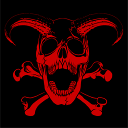
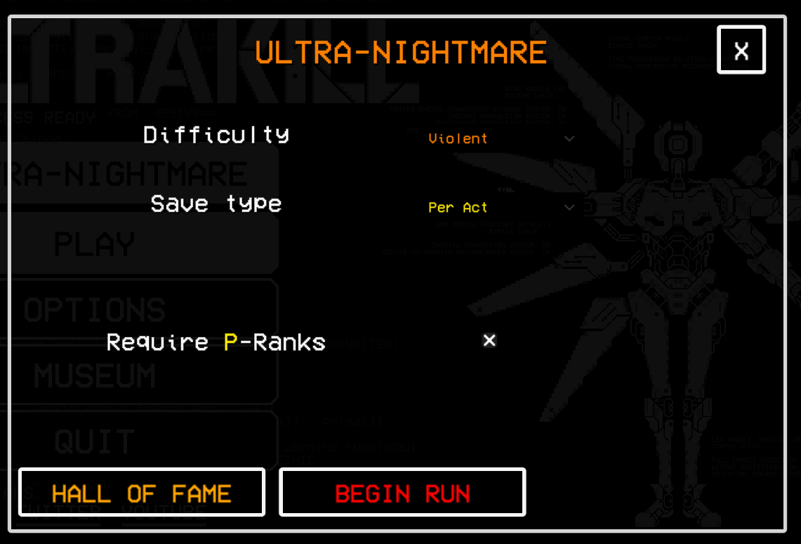
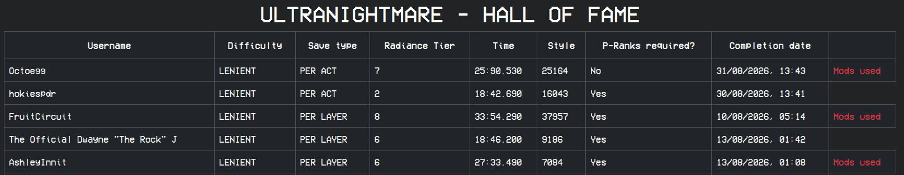
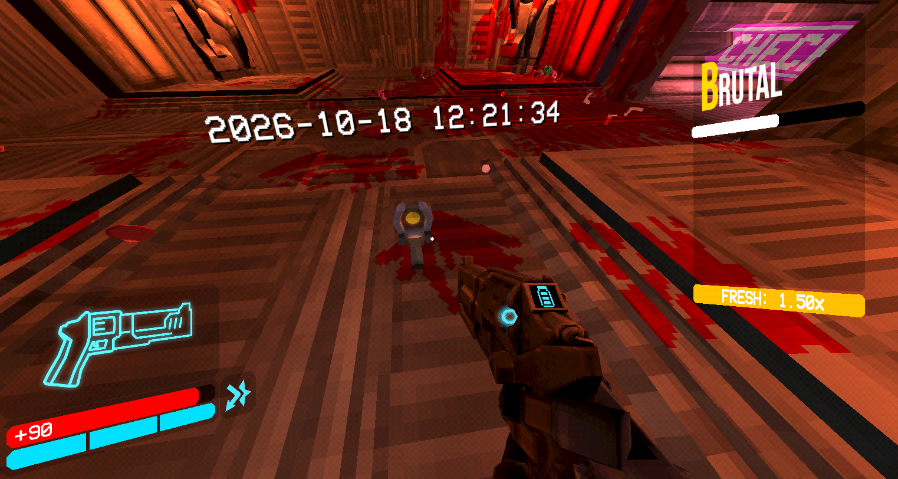
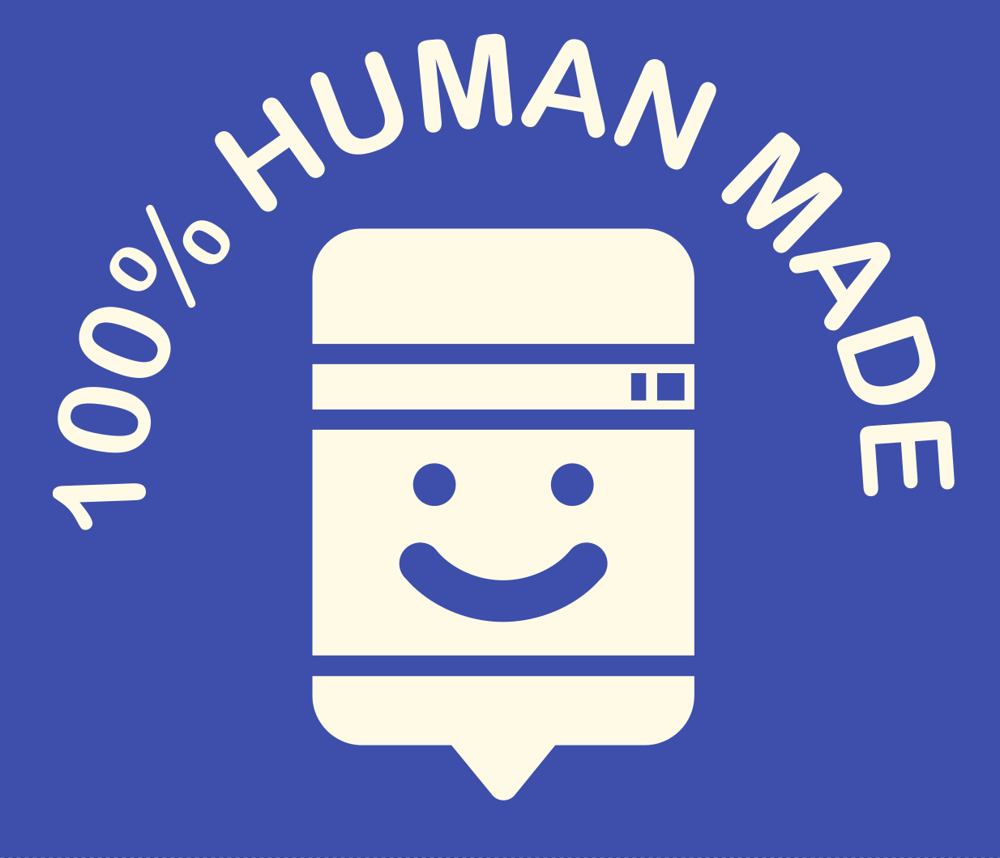

# UltraNightmare

UltraNightmare is a modification (mod) for ULTRAKILL, adding a permadeath challenge to the game, similiar to the Ultra-Nightmare difficulty found in the modern DOOM games.

# Features
- Face off against Hell's residents from Prelude all the way to Fraud with no do-overs - Die once and your run is OVER
- Supports all vanilla difficulties (Harmless to Brutal, Ultrakill Must Die will be available when it is added in the base game)
- Death markers indicate where other players have failed along your journey
- Enforce required P-Ranks & unlockable radiance tiers upon completing a run for extra challenge

# Download & Installation
UltraNightmare is available for download on [Thunderstore](https://thunderstore.io/c/ultrakill/p/Clearwater/UltraNightmare/) (recommended), and as a download package on GitHub.

## How to play
Upon installing the mod, a new option labelled "PLAY ULTRANIGHTMARE" will be presented on the title screen.
Clicking on this button will open a setup panel, allowing you to set the difficulty and settings of the run.

There are three save types:
- **"Per Layer"** allows you to save & quit your current run via the shop at the start of the first level of any layer.
- **"Per Act"** allows you to save & quit your current run at the end of every act via the intermission panel (after completing 3-2 and 6-2)
- **"No saving"** disables saving **entirely**.

Note that regardless of your save type, dying at any point will still wipe your current run entirely and force you to start over from the beginning.

Successfully completing a run from start to end may yield some additional challenges...

### Hall of Fame
Clicking on the Hall Of Fame button in the run setup panel will open the UltraNightmare Hall of Fame website in your browser, which lists all successful runs
of UltraNightmare from every player that came before you.

The Hall Of Fame can also be viewed [here](https://clearwaterbirb.uk/ultranightmare/leaderboards).

### Death markers
While playing through every level, you will be able to see death markers left behind by you in previous runs, as well as death markers of other players
who have also been defeated on their run through Hell. 

Death markers are separated by difficulty, meaning a death marker in a given level on one difficulty will not appear in the same level on another difficulty. 

Future updates to the mod will add additional details to death markers, including Steam usernames and what killed the player. Stay tuned!

# FAQ

### Will this overwrite my existing saves?
No.  UltraNightmare saves run progress to a separate save slot, and will not alter your existing saves. To safeguard against any hypothetical problems though, **backing up your existing saves is STRONGLY recommended!**

### Can I use other mods in conjunction with this?
While you can play UltraNightmare with any other mods of your choosing, to prevent possible cheating and to limit invalid bug reports, **players using non-whitelisted mods will not have completed runs uploaded to the leaderboards or be eligible to unlock radiance tiers.**   
You can view the list of whitelisted mods [here](https://clearwaterbirb.uk/modwhitelist). If you would like to request a mod to be whitelisted, feel free to make an issue for the mod in question and I will take a look at it.

## Donations
If you enjoy my work, please consider donating! All received donations will go directly towards server hosting costs, which will allow me to keep the servers online. Thank you!
  

## Credits & Contributors
- UltraNightmare created by Clearwater  
- UltraNightmare logo by Lenna on Discord (thank you! <3)

### UltraNightmare uses the following libraries and dependencies:
- [JSON.Net](https://github.com/JamesNK/Newtonsoft.Json) by [NewtonSoft](https://www.newtonsoft.com/json), licenced under the MIT Licence.
- [Tommy](https://github.com/dezhidki/Tommy) by [dezhidki](https://github.com/dezhidki), licenced under the MIT Licence.

This project was made from start to finish by humans, with <u>**ZERO**</u> usage of generative AI in any way shape or form. We honor and respect the creative struggle. Support human artists making human art by human hands!

100% Human Made logos created by [TeeKetch](https://bsky.app/profile/teeketch.art).